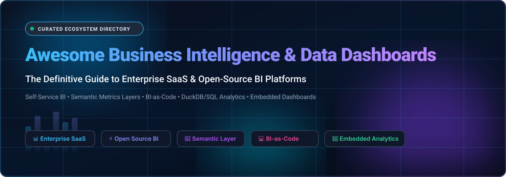

# 📊 Awesome Business Intelligence &amp; Data Dashboards

  

  
  
  
  
  
  

---

## 🌟 Overview &amp; Ecosystem Scope

A curated directory and reference index of top **Enterprise SaaS/Hosted Platforms** and production-grade **Open-Source GitHub Projects** for **Business Intelligence (BI)**, **Interactive Data Dashboards**, **Modern Semantic Layers**, **BI-as-Code**, and **Embedded Analytics**.

Whether you are an analytics engineer orchestrating dbt metrics, a BI architect standardizing corporate governance, a data analyst querying cloud data warehouses (Snowflake, BigQuery, Databricks, Redshift, DuckDB), or a software developer embedding white-label dashboards into customer applications, this repository organizes the modern analytics ecosystem.

---

## 📑 Table of Contents

- [📈 Sector Overview &amp; Market Dynamics](#-sector-overview--market-dynamics)
- [🏢 SaaS &amp; Hosted BI Platforms](#-saas--hosted-bi-platforms)
- [💻 Open-Source GitHub Projects](#-open-source-github-projects)
- [🤝 How to Contribute](#-how-to-contribute)
- [💖 Support &amp; Community](#-support--community)
- [📊 Star History](#-star-history)
- [⚖️ Disclaimer](#-disclaimer)

---

## 📈 Sector Overview &amp; Market Dynamics

The global Business Intelligence &amp; Data Analytics software market is estimated at **$38 billion to $44 billion in 2026**, expanding at a solid CAGR (~11-13%) fueled by generative AI copilots, cloud data warehouse adoption, and real-time operational reporting.

The market structure is **moderately concentrated at the top hyperscaler tier** (dominated by Microsoft Power BI/Fabric, Salesforce Tableau, Google Cloud Looker, and AWS QuickSight leveraging enterprise distribution), while simultaneously exhibiting **high fragmentation across the mid-market and developer layers**. Niche innovators, composable semantic layers, AI-first conversational interfaces, and Git-versioned BI-as-Code alternatives continuously challenge legacy suites and expand self-service analytics across global organizations.

---

## 🏢 SaaS &amp; Hosted BI Platforms

The table below catalogs the leading commercial and enterprise-hosted Business Intelligence platforms, sorted in descending order by parent company scale (annual revenue / enterprise valuation).

| Platform | Company Size (Revenue / Valuation) | Pricing (Specific Starting Tiers) | Free Tier Limits / Free Trial Limits | Focus &amp; Core Strengths |
| :--- | :--- | :--- | :--- | :--- |
| **[Microsoft Power BI](https://microsoft.com)** | ~$245B+ Annual Revenue (Microsoft Corp., $3T+ MCap) | **$14.00 per user/month** (Power BI Pro, billed annually); $24.00 per user/month for Power BI Premium Per User (PPU) | **60-day free trial** of Power BI Pro; free-forever Desktop edition restricted to local authoring, non-collaborative "My Workspace", and no report sharing | Enterprise self-service visual analytics, DAX modeling, native Excel/Office 365 &amp; Microsoft Fabric integration |
| **[Looker (Google Cloud)](https://cloud.google.com/looker)** | ~$100B+ Run Rate (Google Cloud / Alphabet, $2T+ MCap) | **$5,000/month** base platform fee (Looker Standard) + user licenses ($30–$125/user/mo); Looker Studio Pro starts at **$9 per user/project/month** | **30-day free trial** of Google Cloud Looker instance (connects up to 50+ DBs); Looker Studio (basic) is **free forever** for single-author dashboard creation | Governed semantic modeling with LookML, centralized metric layer, high-concurrency embedded analytics |
| **[Tableau Cloud (Salesforce)](https://tableau.com)** | ~$38B+ Annual Revenue (Salesforce, ~$300B MCap) | **$15.00 per user/month** (Viewer); **$42.00 per user/month** (Explorer); **$75.00 per user/month** (Creator, billed annually) | **14-day free trial** of Tableau Cloud Creator (includes Tableau Desktop &amp; Prep Builder, no credit card required); Tableau Public is free for public datasets | Industry-standard drag-and-drop visual exploratory analytics, AI insights (Einstein/Agentforce), governed enterprise reporting |
| **[Qlik Sense (Qlik Cloud)](https://qlik.com)** | ~$1.3B+ Annual Revenue (Thoma Bravo PE) | **$300/month** (Starter Plan, includes 10 users &amp; 10 GB data for analysis); **$825/month** (Standard Plan with 25 GB data) | **30-day full-featured free trial** with collaborative shared spaces, automated pipelines, and no credit card required | Associative analytics engine, in-memory data indexing, automated alerting, and multi-cloud data integration |
| **[Domo](https://domo.com)** | ~$320M Annual Revenue (Publicly traded, Nasdaq: DOMO) | **$30,000/year** estimated entry deployment (consumption credit model with unlimited user seats; paid pools start around $3,000/month) | **30-day free trial** with unlimited credits, Magic ETL connectors, AI chat, and dashboard builders (no credit card required) | Full-stack cloud analytics, 1,000+ pre-built ETL connectors, executive operational dashboards, and mobile BI apps |
| **[ThoughtSpot](https://thoughtspot.com)** | ~$4.5B Valuation (~$200M+ ARR) | **$25.00 per user/month** (Essentials Tier, billed annually for 5–50 users, up to 25M data rows) | **14-day free trial** (up to 25 million rows connected to Snowflake/BigQuery/Databricks, no credit card required) | Search-driven and AI-native analytics, automated natural language querying, interactive Liveboards |
| **[Sisense](https://sisense.com)** | ~$1.2B Valuation (~$150M+ ARR) | **$399/month** (Launch / Self-Serve Tier for startups); customized pricing for Enterprise white-label deployments | **7-day free trial** for self-serve cloud dashboard builder; custom POC trial available for embedded white-label SDK | White-label embedded analytics, composable analytics SDKs, Git integration, and customized multi-tenant customer portals |
| **[GoodData](https://gooddata.com)** | ~$100M+ Valuation / Backing | **$1,500/month** base platform fee for Professional tier (includes analytical workspaces and unlimited users); custom Enterprise tier | **30-day free trial** with full platform capabilities, pre-loaded demo Snowflake warehouse, and semantic modeling SDKs | Composable analytics-as-code, multi-tenant metric governance, Headless BI, and custom embedded applications |
| **[Sigma Computing](https://sigmacomputing.com)** | ~$3.0B Valuation (~$100M+ ARR) | **$17,500 to $35,000/year** entry contract (combines base platform fee + role licenses: Build ~$2,500–$3,500/yr, Analyze/View seats lower) | **7-day free trial** with access to live Snowflake/BigQuery/Databricks warehouse live-querying or pre-loaded demo data | Spreadsheet-native direct-to-warehouse interface, ad-hoc exploratory calculations over billions of cloud data rows |
| **[Metabase Cloud](https://metabase.com)** | ~$75M+ Valuation (~$15M+ ARR) | **$100/month** (Starter Plan, includes 5 users; $6/month per additional user); $500/month base for Pro Plan | **14-day free trial** of Starter or Pro cloud tiers; Open-Source self-hosted edition is **100% free forever** with unlimited users | Intuitive no-code query builder, collaborative SQL editor, automated Slack/email pulses, and embedded analytics |

---

## 💻 Open-Source GitHub Projects

The following table indexes leading open-source Business Intelligence platforms, semantic layers, BI-as-Code frameworks, and dashboard toolkits, **ranked in descending order by GitHub_Stars ⭐**.

| Project | GitHub_Stars | Stargazers Link | Description &amp; Tech Stack |
| :--- | :--- | :--- | :--- |
| **[Grafana](https://github.com/grafana/grafana)** | 78,000+ ⭐ |  | Leading open-source platform for monitoring, time-series metrics, and operational BI dashboards connecting to SQL, Prometheus, ClickHouse, and Loki. *(TypeScript/Go)* |
| **[Apache Superset](https://github.com/apache/superset)** | 75,600+ ⭐ |  | Flagship enterprise open-source modern BI and data exploration platform featuring an advanced SQL IDE, 40+ visualization plugins, and fine-grained RBAC. *(Python/TypeScript)* |
| **[Apache ECharts](https://github.com/apache/echarts)** | 67,700+ ⭐ |  | Highly powerful, interactive charting and data visualization library delivering fluid Canvas/SVG rendering for enterprise web dashboards. *(TypeScript/JavaScript)* |
| **[Metabase](https://github.com/metabase/metabase)** | 50,400+ ⭐ |  | The simplest, fastest open-source way for non-technical teams to explore database data, ask visual questions, run SQL, and embed interactive charts. *(Clojure/JavaScript)* |
| **[Streamlit](https://github.com/streamlit/streamlit)** | 46,400+ ⭐ |  | Popular open-source Python framework that turns data scripts into shareable, interactive machine learning, BI, and data science web dashboards in minutes. *(Python/TypeScript)* |
| **[Redash](https://github.com/getredash/redash)** | 28,800+ ⭐ |  | Battle-tested SQL-first query editor, visualization builder, and collaborative dashboard tool supporting dozens of SQL and NoSQL sources. *(Python/TypeScript)* |
| **[Dash](https://github.com/plotly/dash)** | 24,500+ ⭐ |  | Enterprise-grade Python framework built on top of Plotly.js, React, and Flask for building bespoke, reactive analytic dashboards and data apps. *(Python)* |
| **[PandasAI](https://github.com/gventuri/pandas-ai)** | 23,900+ ⭐ |  | Conversational AI wrapper enabling natural language exploratory data analysis (NL-to-Python/SQL), automated chart generation, and smart data cleaning. *(Python)* |
| **[Cube](https://github.com/cube-js/cube)** | 21,200+ ⭐ |  | Universal semantic layer and headless BI engine providing metric definitions, pre-aggregation caching, and SQL/REST/GraphQL APIs for custom dashboards. *(Rust/TypeScript)* |
| **[Plotly.py](https://github.com/plotly/plotly.py)** | 18,900+ ⭐ |  | Declarative interactive graphing library for Python powering analytical data applications, statistical charts, and financial visual displays. *(Python)* |
| **[PyGWalker](https://github.com/Kanaries/pygwalker)** | 16,000+ ⭐ |  | Lightweight open-source alternative to Tableau that turns pandas/polars DataFrames into interactive visual exploration GUIs inside Jupyter Notebooks. *(Python/TypeScript)* |
| **[dbt-core](https://github.com/dbt-labs/dbt-core)** | 14,100+ ⭐ |  | Foundational open-source data transformation tool enabling analytics engineers to modularize, version-control, document, and test SQL models powering BI. *(Python)* |
| **[Datasette](https://github.com/simonw/datasette)** | 11,600+ ⭐ |  | Multi-tool for exploring, querying, and publishing SQLite and DuckDB databases as instant interactive web dashboards and JSON APIs. *(Python/HTML)* |
| **[RAWGraphs](https://github.com/rawgraphs/rawgraphs-app)** | 9,000+ ⭐ |  | Open-source web-based vector data visualization tool creating missing links between spreadsheets and vector graphics (SVG/PNG). *(JavaScript)* |
| **[Evidence](https://github.com/evidence-dev/evidence)** | 7,100+ ⭐ |  | Open-source BI-as-Code framework that compiles Markdown documents containing embedded SQL queries into fast, version-controlled web dashboards. *(TypeScript/Svelte)* |
| **[Lightdash](https://github.com/lightdash/lightdash)** | 6,200+ ⭐ |  | Open-source Looker alternative built natively on dbt, translating dbt YAML models directly into a governed self-service BI dashboard layer. *(TypeScript)* |
| **[H2O Wave](https://github.com/h2oai/wave)** | 4,200+ ⭐ |  | Real-time software stack for developing interactive AI apps and low-latency operational data dashboards with zero HTML/CSS/JS required. *(Python/Go)* |
| **[Vizro](https://github.com/mckinsey/vizro)** | 3,800+ ⭐ |  | Low-code Python toolkit created by McKinsey built on Dash &amp; Plotly for generating modular, enterprise-ready data visualization dashboards. *(Python)* |
| **[Tremor](https://github.com/tremorlabs/tremor)** | 3,700+ ⭐ |  | Modern React component library designed specifically for building fast, clean, and responsive internal business dashboards. *(TypeScript/React)* |
| **[Observable Framework](https://github.com/observablehq/framework)** | 3,600+ ⭐ |  | Open-source static site generator for data apps pairing polyglot backend data loaders (Python, R, SQL) with reactive client-side JavaScript charts. *(JavaScript)* |
| **[Rill Data](https://github.com/rilldata/rill)** | 3,000+ ⭐ |  | Ultra-fast operational BI and dashboard tool pairing DuckDB/ClickHouse engines with Git-versioned YAML metric definitions for sub-second exploration. *(Go/Svelte)* |
| **[Malloy](https://github.com/malloydata/malloy)** | 2,600+ ⭐ |  | Experimental analytical data language and semantic modeling framework developed by the creators of Looker for nested, relational query pipelines. *(TypeScript)* |

---

## 🤝 How to Contribute

We welcome community suggestions, updates, and additions! Follow these simple steps:

1. 🍴 **Fork** this repository.
2. 🌿 **Create a new branch** (`git checkout -b feature/add-new-bi-tool`).
3. 📝 **Add or update entries** following the tabular format:
   - For SaaS: include specific starting tier price, specific free tier/trial limits, company size, and official documentation links.
   - For Open-Source: include repo link, Stars_Badge (`style=social&color=white`), GitHub stargazers link, and concise tech stack summary.
4. 🚀 **Submit a Pull Request** with a brief summary of your additions.

---

## 💖 Support &amp; Community

Thank you so much for exploring and supporting **Awesome Business Intelligence &amp; Data Dashboards**! 🙌  
If this curated ecosystem reference saved you time, helped you architect your reporting stack, or introduced you to your next favorite analytics tool, please consider showing your support:

- ⭐ **Star this repository** on GitHub to boost visibility across the community.
- 🍴 **Fork and share** the repo with your colleagues, analytics engineering teams, and data communities on LinkedIn, X/Twitter, and Reddit.
- 💬 **Join our community discussion** on [Discord](https://discord.gg/jc4xtF58Ve) to discuss BI architecture, metrics layers, and dashboard best practices.
- ☕ **Buy me a coffee / Sponsor** my ongoing open-source research and maintenance via the [GitHub Sponsors Dashboard](https://github.com/sponsors/ishandutta2007) — every coffee keeps these directories up to date!

---

## 📊 Star History

---

## ⚖️ Disclaimer

- This is a community-curated educational and professional resource; inclusion does not imply formal endorsement.
- All pricing figures, license tiers, trial windows, and valuations are accurate as of latest research and are subject to change by respective vendors.
- When configuring self-hosted or embedded BI solutions, always implement row-level security (RLS), proper TLS encryption, and read-only credential boundaries on production databases.
